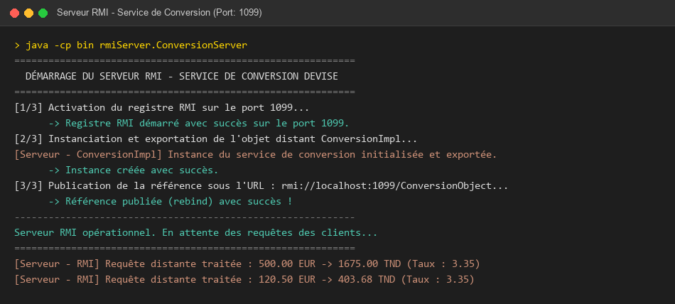
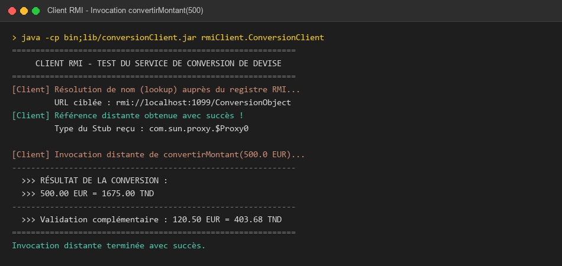
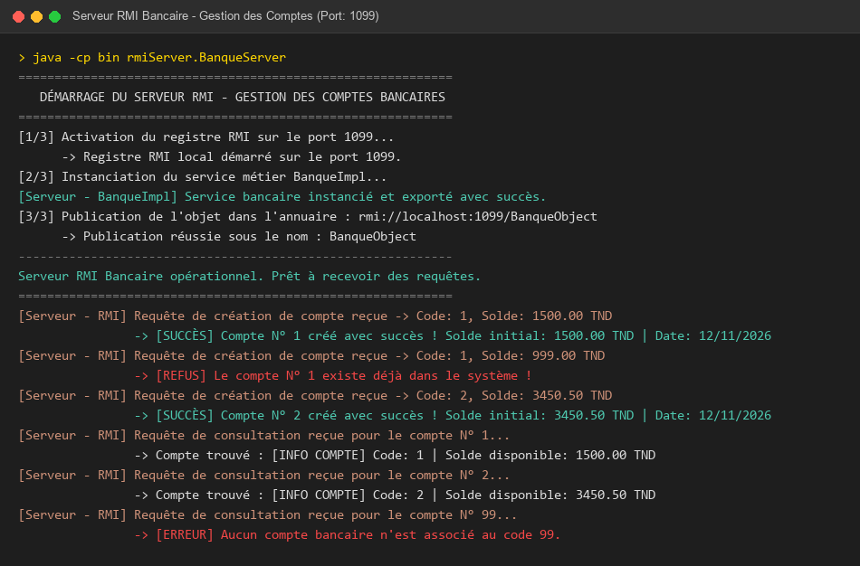
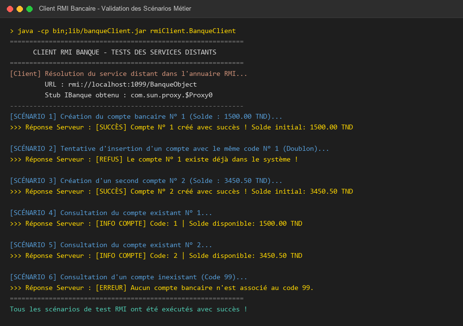
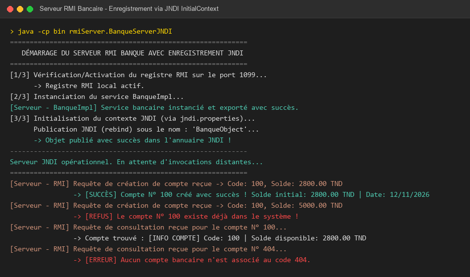
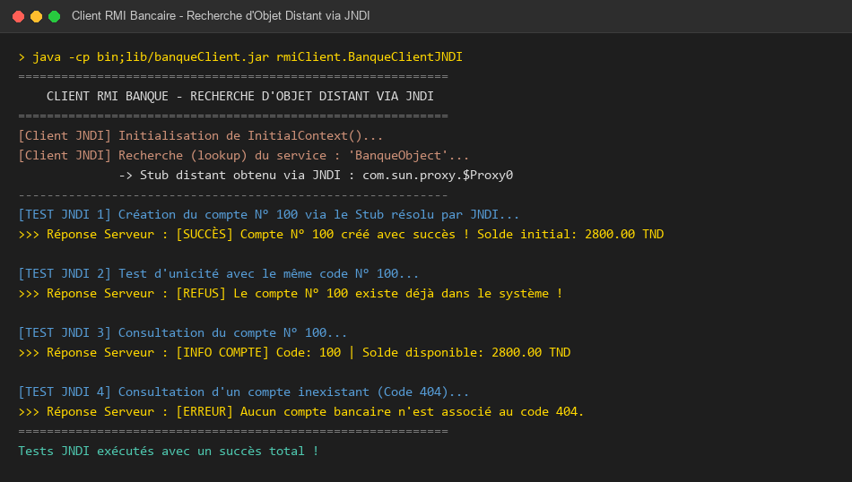

# TP 5 : Invocation de Méthodes Distantes avec Java RMI & JNDI

**Faculté des Sciences de Sfax (FSS)** — Département d'Informatique et des Communications  
**Matière :** Développement d'Applications Réparties (LSI 3)  
**Année Universitaire :** 2026 – 2027  
**Responsable du cours :** Mme Amal ABID  
**Enseignante des TPs :** Mme Zeineb DAOUD  
**Étudiant :** Salmen Zekri  
**Dépôt GitHub :** [https://github.com/zikosalmen/SalmenZekri_LSI3_DevAppReparties](https://github.com/zikosalmen/SalmenZekri_LSI3_DevAppReparties)

---

## Table des Matières
1. [Synthèse Théorique et Académique](#1-synthèse-théorique-et-académique)
   - [1.1. Modèle d'Architecture Java RMI](#11-modèle-darchitecture-java-rmi)
   - [1.2. Cycle de Vie d'un Service Distant](#12-cycle-de-vie-dun-service-distant)
   - [1.3. Sémantique du Passage de Paramètres (Référence vs Copie)](#13-sémantique-du-passage-de-paramètres-référence-vs-copie)
   - [1.4. Couplage Faible et Distribution via Fichiers JAR](#14-couplage-faible-et-distribution-via-fichiers-jar)
   - [1.5. Intégration de JNDI (Java Naming and Directory Interface)](#15-intégration-de-jndi-java-naming-and-directory-interface)
2. [Activité 5-1 : Service de Conversion de Devises](#2-activité-5-1--service-de-conversion-de-devises)
   - [2.1. Spécification de l'Interface Distante `IConversion`](#21-spécification-de-linterface-distante-iconversion)
   - [2.2. Implémentation du Servant `ConversionImpl`](#22-implémentation-du-servant-conversionimpl)
   - [2.3. Déploiement du Serveur `ConversionServer`](#23-déploiement-du-serveur-conversionserver)
   - [2.4. Exportation et Packaging du Client (`conversionClient.jar`)](#24-exportation-et-packaging-du-client-conversionclientjar)
   - [2.5. Implémentation et Invocation Cliente `ConversionClient`](#25-implémentation-et-invocation-cliente-conversionclient)
   - [2.6. Captures d'Écran et Validation (Activité 5-1)](#26-captures-décran-et-validation-activité-5-1)
3. [Activité 5-2 : Service de Banque en Utilisant RMI et JNDI](#3-activité-5-2--service-de-banque-en-utilisant-rmi-et-jndi)
   - [3.1. Modèle Métier Sérialisable `Compte`](#31-modèle-métier-sérialisable-compte)
   - [3.2. Spécification de l'Interface Distante `IBanque`](#32-spécification-de-linterface-distante-ibanque)
   - [3.3. Implémentation du Servant Bancaire `BanqueImpl`](#33-implémentation-du-servant-bancaire-banqueimpl)
   - [3.4. Serveur RMI Classique `BanqueServer` & Client `BanqueClient` (Étape 4)](#34-serveur-rmi-classique-banqueserver--client-banqueclient-étape-4)
   - [3.5. Captures d'Écran RMI Classique (Étape 4)](#35-captures-décran-rmi-classique-étape-4)
   - [3.6. Enregistrement et Recherche via JNDI (Étape 5)](#36-enregistrement-et-recherche-via-jndi-étape-5)
   - [3.7. Captures d'Écran JNDI (Étape 5)](#37-captures-décran-jndi-étape-5)
4. [Structure du Projet et Guide d'Exécution](#4-structure-du-projet-et-guide-dexécution)
   - [4.1. Arborescence du Répertoire](#41-arborescence-du-répertoire)
   - [4.2. Instructions de Compilation et d'Exécution](#42-instructions-de-compilation-et-dexécution)
5. [Livrables ENT](#5-livrables-ent)

---

## 1. Synthèse Théorique et Académique

### 1.1. Modèle d'Architecture Java RMI
**Java RMI (Remote Method Invocation)** est un mécanisme orienté objet permettant à un programme Java s'exécutant sur une Machine Virtuelle Java (JVM) d'invoquer des méthodes sur un objet résidant dans une autre JVM, située sur la même machine physique ou sur un hôte distant connecté par un réseau TCP/IP.

L'architecture RMI repose sur un découpage en trois couches fondamentales :
1. **Couche Application (Stubs & Skeletons) :**
   - **Stub (Proxy dynamique côté Client) :** Agit comme le représentant local de l'objet distant. Il intercepte les appels de méthode du client, sérialise les arguments (*marshalling*), établit la liaison réseau et attend la réponse.
   - **Skeleton / Dispatcher (Côté Serveur) :** Reçoit le flux binaire, désérialise les paramètres (*unmarshalling*), appelle la méthode effective sur l'instance de l'objet métier (*Servant*), puis sérialise le résultat de retour ou l'exception levée.
2. **Couche Référence Distante (Remote Reference Layer - RRL) :**
   - Gère la sémantique de communication unicast point-à-point, la résolution des références et le maintien de la session logique.
3. **Couche Transport :**
   - Implémente le protocole de communication sous-jacent **JRMP (Java Remote Method Protocol)** au-dessus des sockets TCP/IP standards.

```
+---------------------+                      +---------------------+
|     JVM CLIENT      |                      |     JVM SERVEUR     |
|  ConversionClient   |                      |   ConversionServer  |
|          |          |                      |          ^          |
|          v          |                      |          |          |
|   Stub (Proxy RMI)  |                      |   Servant (Impl)    |
+----------|----------+                      +----------^----------+
           | (Marshalling)                              | (Dispatch)
           v                                            |
+---------------------+                      +---------------------+
| Remote Ref. Layer   |                      | Remote Ref. Layer   |
+----------|----------+                      +----------^----------+
           | (JRMP/TCP)                                 | (Unmarshalling)
           +===============[ Rseau TCP/IP ]============+
                                  ^
                                  |
                      +-----------------------+
                      |   RMIRegistry (1099)  |
                      | (Annuaire de nommage) |
                      +-----------------------+
```

---

### 1.2. Cycle de Vie d'un Service Distant
Le cycle de vie complet d'un composant distribué RMI obéit à quatre phases chronologiques rigoureuses :
1. **Définition du contrat (Interface Distante) :** Création d'une interface étendant obligatoirement `java.rmi.Remote`. Chaque méthode doit déclarer `throws RemoteException` afin d'anticiper les défaillances réseau (latence, déconnexion, pannes partielles modélisées par les *Fallacies of Distributed Computing*).
2. **Implémentation du Servant :** Définition d'une classe concrète qui hérite de `java.rmi.server.UnicastRemoteObject`. Lors de l'instanciation, son constructeur exporte l'objet en ouvrant un socket TCP d'écoute anonyme.
3. **Enregistrement et Publication (*Binding*) :** Le serveur démarre le registre d'annuaire (`LocateRegistry.createRegistry(1099)`) et publie le stub de l'objet sous un nom symbolique via `Naming.rebind("rmi://localhost:1099/NomService", instance)`.
4. **Recherche et Invocation (*Lookup & Call*) :** Le client interroge l'annuaire via `Naming.lookup(...)`, obtient une référence sur le stub, transtype vers l'interface distante et exécute la méthode de manière totalement transparente.

---

### 1.3. Sémantique du Passage de Paramètres (Référence vs Copie)
Dans les architectures distribuées, le partage direct d'espace mémoire est impossible entre deux JVM distinctes. RMI applique donc deux stratégies orthogonales :

| Type d'Élément | Mécanisme de Transmission | Sémantique | Exemple dans le TP |
| :--- | :--- | :--- | :--- |
| **Objet Distant (Servant)** | Passé **par Référence** | Le client reçoit un **Stub** (Proxy dynamique). L'état réel reste sur le serveur. | `IConversion`, `IBanque` |
| **Objet Métier (DTO)** | Passé **par Valeur** (Copie) | Sérialisation binaire complète de l'état (*Deep Copy*). Nécessite `implements Serializable`. | `metier.Compte` |
| **Types Primitifs / Strings** | Passé **par Valeur** | Copie directe des octets dans la trame réseau. | `double mt`, `int code`, `String` |

---

### 1.4. Couplage Faible et Distribution via Fichiers JAR
Pour préserver l'étanchéité architecturale et la sécurité :
* Le client ne doit **jamais** posséder le code source ou le bytecode des classes d'implémentation serveur (`ConversionImpl`, `BanqueImpl`).
* Seules l'interface distante (`IConversion`, `IBanque`) et les classes de données sérialisables (`Compte`) sont exportées dans une archive `.jar` (`conversionClient.jar`, `banqueClient.jar`) et ajoutées au *Classpath* du client.
* Cette séparation garantit une indépendance totale : l'implémentation interne du serveur peut évoluer sans impacter ni recompiler les applications clientes.

---

### 1.5. Intégration de JNDI (Java Naming and Directory Interface)
Dans l'Activité 5-2 (Étape 5), RMI est couplé à **JNDI**.  
JNDI est une API unifiée fournissant une couche d'abstraction (SPI - *Service Provider Interface*) au-dessus de services d'annuaires hétérogènes (RMI Registry, LDAP, CORBA COS Naming, DNS).

* **Pourquoi utiliser JNDI ?**  
  L'utilisation directe de `LocateRegistry` ou `Naming` couple le code source au protocole RMI. Avec JNDI, l'application manipule l'interface standard `javax.naming.Context` et instancie un `InitialContext`.
* **Configuration déclarative (`jndi.properties`) :**  
  Les paramètres de connexion sont déportés hors du code Java dans un fichier situé à la racine du Classpath (`src`) :
  ```properties
  java.naming.factory.initial=com.sun.jndi.rmi.registry.RegistryContextFactory
  java.naming.provider.url=rmi://localhost:1099
  ```
* **Opérations standardisées :**  
  - Enregistrement serveur : `context.rebind("BanqueObject", service);`
  - Résolution cliente : `IBanque b = (IBanque) context.lookup("BanqueObject");`

---

## 2. Activité 5-1 : Service de Conversion de Devises

L'objectif de cette activité est de concevoir un service réparti permettant de convertir un montant exprimé en Euros vers le Dinar Tunisien (TND).

### 2.1. Spécification de l'Interface Distante `IConversion`
Fichier : `RMIConversion_Server/src/rmiService/IConversion.java`

```java
package rmiService;

import java.rmi.Remote;
import java.rmi.RemoteException;

public interface IConversion extends Remote {
    /**
     * Convertit un montant en Euros vers le Dinar Tunisien.
     * @param mt Montant en Euros.
     * @return Montant converti en TND.
     * @throws RemoteException En cas d'erreur de communication réseau.
     */
    double convertirMontant(double mt) throws RemoteException;
}
```

---

### 2.2. Implémentation du Servant `ConversionImpl`
Fichier : `RMIConversion_Server/src/rmiService/ConversionImpl.java`

```java
package rmiService;

import java.rmi.RemoteException;
import java.rmi.server.UnicastRemoteObject;

public class ConversionImpl extends UnicastRemoteObject implements IConversion {

    private static final long serialVersionUID = 1L;
    private static final double TAUX_CONVERSION = 3.35; // 1 EUR = 3.35 TND

    public ConversionImpl() throws RemoteException {
        super(); // Exporte l'objet sur un socket TCP anonyme
    }

    @Override
    public double convertirMontant(double mt) throws RemoteException {
        double resultat = mt * TAUX_CONVERSION;
        System.out.printf("[Serveur] Requte traite : %.2f EUR -> %.2f TND%n", mt, resultat);
        return resultat;
    }
}
```

---

### 2.3. Déploiement du Serveur `ConversionServer`
Fichier : `RMIConversion_Server/src/rmiServer/ConversionServer.java`

```java
package rmiServer;

import java.rmi.Naming;
import java.rmi.registry.LocateRegistry;
import rmiService.ConversionImpl;

public class ConversionServer {
    public static final int RMI_PORT = 1099;
    public static final String SERVICE_NAME = "ConversionObject";

    public static void main(String[] args) {
        try {
            // 1. Activation de l'annuaire RMIRegistry
            LocateRegistry.createRegistry(RMI_PORT);
            System.out.println("[Serveur] RMIRegistry dmarr sur le port " + RMI_PORT);

            // 2. Instanciation du servant
            ConversionImpl conversionService = new ConversionImpl();

            // 3. Publication de la rfrence dans l'annuaire
            String url = "rmi://localhost:" + RMI_PORT + "/" + SERVICE_NAME;
            Naming.rebind(url, conversionService);
            System.out.println("[Serveur] Objet publi avec succs sous : " + url);
        } catch (Exception e) {
            e.printStackTrace();
        }
    }
}
```

---

### 2.4. Exportation et Packaging du Client (`conversionClient.jar`)
Conformément à l'Étape 3 du sujet :
1. Seul le bytecode de l'interface `rmiService/IConversion.class` est sélectionné.
2. La commande de packaging génère l'archive :
   ```bash
   jar -cvf conversionClient.jar rmiService/IConversion.class
   ```
3. L'archive est placée dans `RMIConversion_Client/lib/` et intégrée au Classpath du projet client.

---

### 2.5. Implémentation et Invocation Cliente `ConversionClient`
Fichier : `RMIConversion_Client/src/rmiClient/ConversionClient.java`

```java
package rmiClient;

import java.rmi.Naming;
import rmiService.IConversion;

public class ConversionClient {
    public static void main(String[] args) {
        try {
            // Recherche de la rfrence distante dans l'annuaire
            IConversion stub = (IConversion) Naming.lookup("rmi://localhost:1099/ConversionObject");

            // Invocation de la mthode distante demande dans le TP : convertirMontant(500)
            double montant = 500.0;
            double montantConverti = stub.convertirMontant(montant);

            System.out.printf("Rsultat de la conversion : %.2f EUR = %.2f TND%n", 
                              montant, montantConverti);
        } catch (Exception e) {
            e.printStackTrace();
        }
    }
}
```

---

### 2.6. Captures d'Écran et Validation (Activité 5-1)

#### Console Serveur (`ConversionServer`) :
Démarrage du registre, exportation du servant, publication dans l'annuaire et traitement de la requête distante de 500.00 EUR :


#### Console Client (`ConversionClient`) :
Lookup du stub, invocation distante et réception du résultat exact `500.00 EUR = 1675.00 TND` :


---

## 3. Activité 5-2 : Service de Banque en Utilisant RMI et JNDI

L'application gère des comptes bancaires caractérisés par un code (`int`), un solde (`double`) et une date de création (`Date`).

### 3.1. Modèle Métier Sérialisable `Compte`
Fichier : `RMIBanque_Server/src/metier/Compte.java`

```java
package metier;

import java.io.Serializable;
import java.util.Date;

public class Compte implements Serializable {
    private static final long serialVersionUID = 1L;
    
    private int code;
    private double solde;
    private Date dateCreation;

    public Compte() { this.dateCreation = new Date(); }

    public Compte(int code, double solde, Date dateCreation) {
        this.code = code;
        this.solde = solde;
        this.dateCreation = (dateCreation != null) ? dateCreation : new Date();
    }

    public int getCode() { return code; }
    public void setCode(int code) { this.code = code; }
    public double getSolde() { return solde; }
    public void setSolde(double solde) { this.solde = solde; }
    public Date getDateCreation() { return dateCreation; }
    public void setDateCreation(Date dateCreation) { this.dateCreation = dateCreation; }
}
```

---

### 3.2. Spécification de l'Interface Distante `IBanque`
Fichier : `RMIBanque_Server/src/rmiService/IBanque.java`

```java
package rmiService;

import java.rmi.Remote;
import java.rmi.RemoteException;
import metier.Compte;

public interface IBanque extends Remote {
    String creerCompte(Compte c) throws RemoteException;
    String getInfoCompte(int code) throws RemoteException;
}
```

---

### 3.3. Implémentation du Servant Bancaire `BanqueImpl`
Fichier : `RMIBanque_Server/src/rmiService/BanqueImpl.java`

```java
package rmiService;

import java.rmi.RemoteException;
import java.rmi.server.UnicastRemoteObject;
import java.util.Map;
import java.util.concurrent.ConcurrentHashMap;
import metier.Compte;

public class BanqueImpl extends UnicastRemoteObject implements IBanque {

    private final Map<Integer, Compte> comptes = new ConcurrentHashMap<>();

    public BanqueImpl() throws RemoteException { super(); }

    @Override
    public String creerCompte(Compte c) throws RemoteException {
        if (comptes.containsKey(c.getCode())) {
            return "[REFUS] Le compte N " + c.getCode() + " existe dj dans le systme !";
        }
        comptes.put(c.getCode(), c);
        return String.format("[SUCCS] Compte N %d cr avec succs ! Solde initial: %.2f TND", 
                             c.getCode(), c.getSolde());
    }

    @Override
    public String getInfoCompte(int code) throws RemoteException {
        Compte c = comptes.get(code);
        if (c != null) {
            return String.format("[INFO COMPTE] Code: %d | Solde disponible: %.2f TND | Date: %s",
                                 c.getCode(), c.getSolde(), c.getDateCreation());
        }
        return "[ERREUR] Aucun compte bancaire n'est associ au code " + code + ".";
    }
}
```

---

### 3.4. Serveur RMI Classique `BanqueServer` & Client `BanqueClient` (Étape 4)

* **Serveur RMI (`BanqueServer.java`) :** Initialise le registre RMI local sur le port 1099 et publie l'instance `BanqueImpl` via `Naming.rebind("rmi://localhost:1099/BanqueObject", banqueService);`.
* **Client RMI (`BanqueClient.java`) :** Se connecte via `(IBanque) Naming.lookup("rmi://localhost:1099/BanqueObject");` et valide la matrice de tests :
  1. Création du compte N° 1 (1500.00 TND) -> Succès.
  2. Tentative de recréation du compte N° 1 (Doublon) -> Refus net par le serveur.
  3. Création du compte N° 2 (3450.50 TND) -> Succès.
  4. Consultation du compte N° 1 -> Données récupérées avec solde et date.
  5. Consultation du compte inexistant N° 99 -> Message d'erreur contrôlé.

---

### 3.5. Captures d'Écran RMI Classique (Étape 4)

#### Console Serveur RMI (`BanqueServer`) :


#### Console Client RMI (`BanqueClient`) :


---

### 3.6. Enregistrement et Recherche via JNDI (Étape 5)

Conformément à l'Étape 5 du sujet, l'enregistrement et la résolution des objets sont migrés vers **JNDI**.

#### Fichier de configuration `jndi.properties`
Placé dans le dossier `src/` du Serveur et du Client :
```properties
java.naming.factory.initial=com.sun.jndi.rmi.registry.RegistryContextFactory
java.naming.provider.url=rmi://localhost:1099
```

#### Enregistrement JNDI Côté Serveur (`BanqueServerJNDI.java`) :
```java
// Initialisation du contexte JNDI par dfaut bas sur jndi.properties
Context ctx = new InitialContext();

// Publication (Binding) de l'objet distant
ctx.rebind("BanqueObject", banqueService);
System.out.println("[Serveur JNDI] Objet publi avec succs sous 'BanqueObject'");
```

#### Résolution JNDI Côté Client (`BanqueClientJNDI.java`) :
```java
// Rcupration du contexte JNDI
Context ctx = new InitialContext();

// Recherche (Lookup) du service via JNDI
IBanque banque = (IBanque) ctx.lookup("BanqueObject");

// Invocation distante
String reponse = banque.creerCompte(new Compte(100, 2800.0, new Date()));
System.out.println(reponse);
```

---

### 3.7. Captures d'Écran JNDI (Étape 5)

#### Console Serveur JNDI (`BanqueServerJNDI`) :
Publication du service sous l'annuaire JNDI et traitement des requêtes distantes :


#### Console Client JNDI (`BanqueClientJNDI`) :
Résolution via `InitialContext.lookup("BanqueObject")` et validation des opérations bancaires :


---

## 4. Structure du Projet et Guide d'Exécution

### 4.1. Arborescence du Répertoire
L'espace de travail est structuré de façon modulaire et directement compatible avec **Eclipse IDE**, **IntelliJ IDEA**, **VS Code** ou les outils CLI du JDK :

```text
SalmenZekri_LSI3_DevAppReparties/
├── RMIConversion_Server/
│   ├── .project
│   ├── .classpath
│   └── src/
│       ├── rmiService/
│       │   ├── IConversion.java
│       │   └── ConversionImpl.java
│       └── rmiServer/
│           └── ConversionServer.java
├── RMIConversion_Client/
│   ├── .project
│   ├── .classpath
│   ├── lib/
│   │   └── conversionClient.jar      <-- Contient uniquement IConversion.class
│   └── src/
│       └── rmiClient/
│           └── ConversionClient.java
├── RMIBanque_Server/
│   ├── .project
│   ├── .classpath
│   └── src/
│       ├── jndi.properties           <-- Configuration du provider JNDI
│       ├── metier/
│       │   └── Compte.java           <-- Entit srialisable (Serializable)
│       ├── rmiService/
│       │   ├── IBanque.java          <-- Interface distante
│       │   └── BanqueImpl.java       <-- Servant UnicastRemoteObject
│       └── rmiServer/
│           ├── BanqueServer.java     <-- Enregistrement Naming standard
│           └── BanqueServerJNDI.java <-- Enregistrement JNDI InitialContext
├── RMIBanque_Client/
│   ├── .project
│   ├── .classpath
│   ├── lib/
│   │   └── banqueClient.jar          <-- Contient IBanque.class + Compte.class
│   └── src/
│       ├── jndi.properties           <-- Configuration du provider JNDI
│       └── rmiClient/
│           ├── BanqueClient.java     <-- Lookup Naming standard
│           └── BanqueClientJNDI.java <-- Lookup JNDI InitialContext
├── captures/                         <-- Captures d'cran des terminaux
├── build_all.bat                     <-- Script de compilation globale et export JAR
└── README.md                         <-- Rapport technique et synthse
```

---

### 4.2. Instructions de Compilation et d'Exécution

#### Méthode 1 : Script d'automatisation Batch (Windows)
Double-cliquez sur `build_all.bat` (ou lancez-le dans l'invite de commande) pour compiler automatiquement les 4 projets et générer les archives `conversionClient.jar` et `banqueClient.jar`.

#### Méthode 2 : Ligne de Commande Manuelle (JDK 1.8+)

1. **Compiler et Lancer Activité 5-1 :**
   ```bash
   # 1. Compilation Serveur et cration du JAR
   cd SalmenZekri_LSI3_DevAppReparties/RMIConversion_Server
   javac -encoding UTF-8 -d bin src/rmiService/*.java src/rmiServer/*.java
   cd bin
   jar -cvf ../../RMIConversion_Client/lib/conversionClient.jar rmiService/IConversion.class

   # 2. Dmarrage du Serveur Conversion
   cd ..
   java -cp bin rmiServer.ConversionServer

   # 3. Dans un second terminal : Compilation et excution Client
   cd SalmenZekri_LSI3_DevAppReparties/RMIConversion_Client
   javac -encoding UTF-8 -cp "lib/conversionClient.jar" -d bin src/rmiClient/ConversionClient.java
   java -cp "bin;lib/conversionClient.jar" rmiClient.ConversionClient
   ```

2. **Compiler et Lancer Activité 5-2 (RMI Standard & JNDI) :**
   ```bash
   # 1. Compilation Serveur Banque et cration du JAR
   cd SalmenZekri_LSI3_DevAppReparties/RMIBanque_Server
   javac -encoding UTF-8 -d bin src/metier/*.java src/rmiService/*.java src/rmiServer/*.java
   copy src/jndi.properties bin/jndi.properties
   cd bin
   jar -cvf ../../RMIBanque_Client/lib/banqueClient.jar rmiService/IBanque.class metier/Compte.class

   # 2. Compilation Client Banque
   cd ../../RMIBanque_Client
   javac -encoding UTF-8 -cp "lib/banqueClient.jar" -d bin src/rmiClient/*.java
   copy src/jndi.properties bin/jndi.properties

   # 3. Test RMI Standard (tape 4) :
   # Terminal 1 :
   java -cp bin rmiServer.BanqueServer
   # Terminal 2 :
   java -cp "bin;lib/banqueClient.jar" rmiClient.BanqueClient

   # 4. Test Intgration JNDI (tape 5) :
   # Terminal 1 :
   java -cp bin rmiServer.BanqueServerJNDI
   # Terminal 2 :
   java -cp "bin;lib/banqueClient.jar" rmiClient.BanqueClientJNDI
   ```

---

## 5. Livrables ENT

1. **Lien du repository GitHub :** [https://github.com/zikosalmen/SalmenZekri_LSI3_DevAppReparties](https://github.com/zikosalmen/SalmenZekri_LSI3_DevAppReparties)
2. **Fichier `README.md` :** Présente la synthèse exhaustive, les explications architecturales et les captures d'écran des terminaux pour chaque activité et étape.
